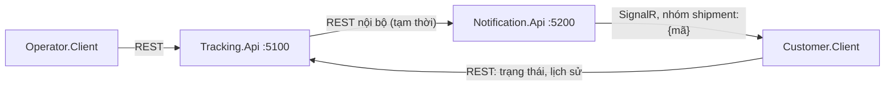

# Shipment Tracking – Hệ thống theo dõi bưu gửi (Đề tài 08)

Học phần Phát triển ứng dụng phân tán. Hệ thống quản lý và theo dõi hành trình bưu gửi qua nhiều điểm xử lý.

> **Trạng thái: tuần 2.** Có REST API (dữ liệu trong bộ nhớ), Notification.Api đẩy thông báo thời gian thực bằng SignalR, máy khách Operator và Customer. Cơ sở dữ liệu, RabbitMQ, Docker được bổ sung ở các tuần sau.

## Kiến trúc hiện tại



| Dự án | Vai trò |
|---|---|
| `src/Tracking.Contracts` | Hợp đồng dùng chung: DTO, enum, mã lỗi, máy trạng thái, mã theo dõi, cấu hình JSON, tên phương thức SignalR |
| `src/Tracking.Api` | REST API, nguồn sự thật của dữ liệu bưu gửi |
| `src/Notification.Api` | Hub SignalR, đẩy thông báo đến đúng nhóm bưu gửi |
| `src/Operator.Client` | Máy khách nhân viên: tạo bưu gửi, cập nhật trạng thái |
| `src/Customer.Client` | Máy khách khách hàng: theo dõi bưu gửi, nhận thông báo thời gian thực |
| `tests/Tracking.Api.Tests` | Kiểm thử đơn vị (xUnit) |
| `http/shipments.http` | Request mẫu (REST Client) |

Các tiến trình chỉ chia sẻ `Tracking.Contracts`, không tham chiếu code của nhau.

### Thông báo thời gian thực

- Customer gọi `WatchShipment(mã)` để vào nhóm `shipment:{MÃ}`, rồi mới lấy trạng thái và lịch sử qua REST.
- Thông báo chỉ là tiện ích; dữ liệu đúng luôn nằm ở Tracking.Api. Khi kết nối lại, Customer vào nhóm lại và gọi REST để bù sự kiện bị lỡ, bỏ qua bản trùng theo `EventId`.
- Nếu Notification.Api tắt, việc cập nhật trạng thái vẫn thành công (Tracking.Api chỉ ghi log). Thông báo trong lúc đó bị mất; tuần 5 thay đường gọi nội bộ bằng RabbitMQ để khắc phục.

## Yêu cầu

- .NET SDK 10
- Visual Studio Code (khuyến nghị cài thêm C# Dev Kit, REST Client)

## Chạy hệ thống

Mỗi lệnh chạy trong một terminal riêng:

```powershell
dotnet run --project src/Tracking.Api        # cổng 5100
dotnet run --project src/Notification.Api    # cổng 5200
dotnet run --project src/Operator.Client
dotnet run --project src/Customer.Client
```

Cấu hình địa chỉ bằng biến môi trường: `TRACKING_API_URL` (Operator, Customer), `NOTIFICATION_API_URL` (Tracking.Api, Customer).

```powershell
dotnet run --project src/Operator.Client -- http://localhost:5100
```

## Chạy kiểm thử

```powershell
dotnet test
```

## API

| Phương thức | Đường dẫn | Mô tả | Mã trả về |
|---|---|---|---|
| POST | `/shipments` | Tạo bưu gửi, sinh mã theo dõi | 201, 400 |
| GET | `/shipments/{trackingCode}` | Trạng thái hiện tại | 200, 404 |
| POST | `/shipments/{trackingCode}/events` | Thêm sự kiện, đổi trạng thái | 201, 400, 404, 409 |
| GET | `/shipments/{trackingCode}/history` | Lịch sử hành trình (cũ nhất trước) | 200, 404 |
| GET | `/health` | Kiểm tra dịch vụ | 200 |

Lỗi nghiệp vụ trả về `{ "code": "...", "message": "..." }` với `code` là một trong:

| Mã lỗi | Ý nghĩa |
|---|---|
| `INVALID_SHIPMENT` | Thiếu tên hoặc địa chỉ người gửi/nhận |
| `INVALID_EVENT` | Thiếu vị trí, trạng thái không hợp lệ hoặc là `Created` |
| `SHIPMENT_NOT_FOUND` | Mã không tồn tại hoặc sai định dạng |
| `INVALID_TRANSITION` | Không được chuyển sang trạng thái này từ trạng thái hiện tại |

Mã theo dõi có dạng `VN` + `yyMMdd` (ngày UTC) + 6 ký tự (không có I, O, 0, 1). API chấp nhận mã viết thường và tự chuẩn hóa.

## Trạng thái hợp lệ

| Từ \ Đến | InTransit | AtHub | Delivered | Failed |
|---|---|---|---|---|
| Created | ✓ | | | |
| InTransit | | ✓ | ✓ | ✓ |
| AtHub | ✓ | | ✓ | ✓ |
| Failed | ✓ | | | |
| Delivered | (trạng thái cuối) | | | |

`Created` chỉ được sinh ra khi tạo bưu gửi, không gửi được qua sự kiện.