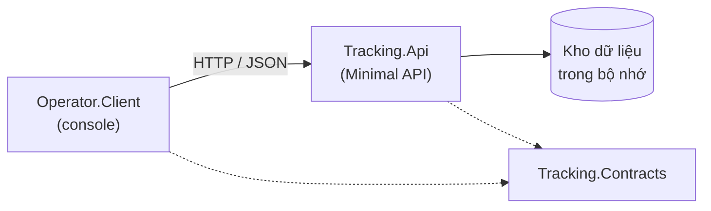

# Shipment Tracking – Hệ thống theo dõi bưu gửi (Đề tài 08)

Học phần Phát triển ứng dụng phân tán. Hệ thống quản lý và theo dõi hành trình bưu gửi qua nhiều điểm xử lý.

> **Trạng thái: tuần 1.** Hiện có REST API (dữ liệu lưu trong bộ nhớ, mất khi tắt API) và máy khách dòng lệnh cho Operator. Các thành phần khác (SignalR, cơ sở dữ liệu, RabbitMQ, Docker) được bổ sung ở các tuần sau.

## Kiến trúc hiện tại



| Dự án | Vai trò |
|---|---|
| `src/Tracking.Contracts` | Hợp đồng dùng chung: DTO, enum trạng thái, mã lỗi, máy trạng thái, sinh và chuẩn hóa mã theo dõi, cấu hình JSON |
| `src/Tracking.Api` | Máy chủ REST: nhận request, kiểm tra đầu vào, gọi kho dữ liệu, trả mã HTTP |
| `src/Operator.Client` | Máy khách console: menu tạo bưu gửi, cập nhật trạng thái, tra cứu |
| `tests/Tracking.Api.Tests` | Kiểm thử đơn vị (xUnit) |
| `http/shipments.http` | Các request mẫu (extension REST Client của VS Code) |

Hai tiến trình chỉ chia sẻ `Tracking.Contracts`; client không tham chiếu `Tracking.Api`.

## Yêu cầu

- .NET SDK 10
- Visual Studio Code (khuyến nghị cài thêm C# Dev Kit, REST Client)

## Chạy hệ thống

```powershell
# Terminal 1: API (cổng 5100)
dotnet run --project src/Tracking.Api

# Terminal 2: máy khách Operator
dotnet run --project src/Operator.Client
```

Địa chỉ API của client lấy theo thứ tự: tham số dòng lệnh, biến môi trường `TRACKING_API_URL`, mặc định `http://localhost:5100`.

```powershell
dotnet run --project src/Operator.Client -- http://localhost:5100
```

## Chạy kiểm thử

```powershell
dotnet test
```

## API

| Phương thức | Đường dẫn | Mô tả | Mã trả về |
|---|---|---|---|
| POST | `/shipments` | Tạo bưu gửi, sinh mã theo dõi | 201, 400 |
| GET | `/shipments/{trackingCode}` | Trạng thái hiện tại | 200, 404 |
| POST | `/shipments/{trackingCode}/events` | Thêm sự kiện, đổi trạng thái | 201, 400, 404, 409 |
| GET | `/shipments/{trackingCode}/history` | Lịch sử hành trình (cũ nhất trước) | 200, 404 |
| GET | `/health` | Kiểm tra dịch vụ | 200 |

Lỗi nghiệp vụ trả về `{ "code": "...", "message": "..." }` với `code` là một trong:

| Mã lỗi | Ý nghĩa |
|---|---|
| `INVALID_SHIPMENT` | Thiếu tên hoặc địa chỉ người gửi/nhận |
| `INVALID_EVENT` | Thiếu vị trí, trạng thái không hợp lệ hoặc là `Created` |
| `SHIPMENT_NOT_FOUND` | Mã không tồn tại hoặc sai định dạng |
| `INVALID_TRANSITION` | Không được chuyển sang trạng thái này từ trạng thái hiện tại |

Mã theo dõi có dạng `VN` + `yyMMdd` (ngày UTC) + 6 ký tự (không có I, O, 0, 1). API chấp nhận mã viết thường và tự chuẩn hóa.

## Trạng thái hợp lệ

| Từ \ Đến | InTransit | AtHub | Delivered | Failed |
|---|---|---|---|---|
| Created | ✓ | | | |
| InTransit | | ✓ | ✓ | ✓ |
| AtHub | ✓ | | ✓ | ✓ |
| Failed | ✓ | | | |
| Delivered | (trạng thái cuối) | | | |

`Created` chỉ được sinh ra khi tạo bưu gửi, không gửi được qua sự kiện.